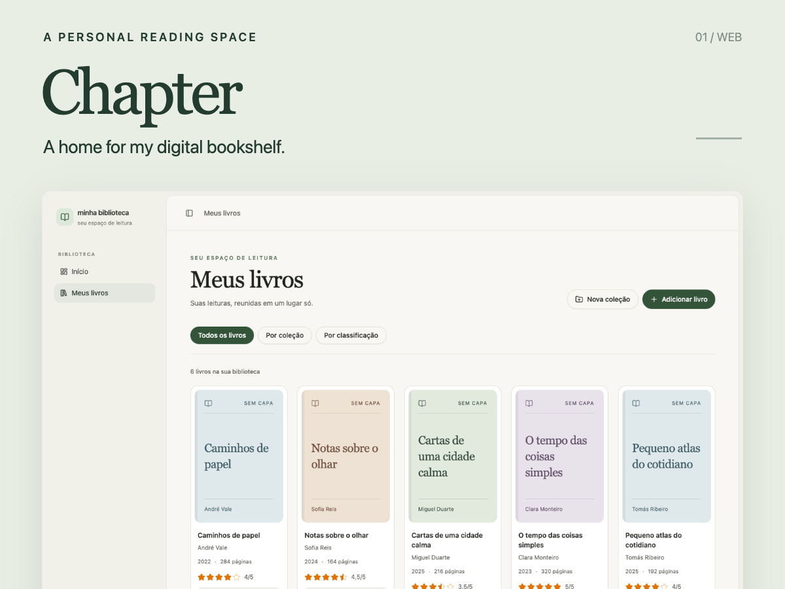
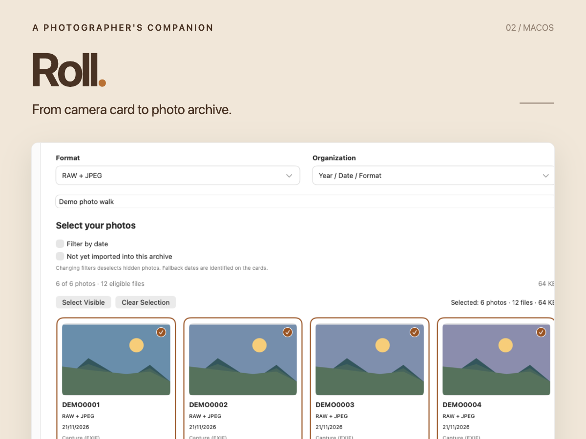

# Lucas Cacao

**Software Engineer · Backend & Business Systems**

I'm a Brazilian **software engineer** working on systems with complex business rules. Much of my work involves understanding existing software, investigating problems, and improving it with care for **data integrity**.

I bring that same approach to AI-assisted development: exploring ideas, *questioning assumptions*, reviewing the code, and testing what actually works.

**PHP and Laravel** are central to my work. My personal projects grow out of photography, reading, and things I want to make easier.

### Things I'm building

<table>
  <tr>
    <td width="50%" valign="top">
      
      <h3><a href="https://github.com/lucascacao95/chapter">Chapter ↗</a></h3>
      
<em>A home for my digital bookshelf.</em>

      
Organize EPUBs and PDFs, keep ratings and notes, and share selected reading activity. Includes an email-based Send to Kindle proof of concept.

      
<strong>Engineering focus:</strong> background file processing, versioned ratings, and user-owned data.

      
Laravel · Vue · TypeScript

      
In development

    </td>
    <td width="50%" valign="top">
      
      <h3><a href="https://github.com/lucascacao95/roll">Roll ↗</a></h3>
      
<em>From camera card to photo archive.</em>

      
A native macOS app for selecting and organizing RAW and JPEG photographs, with import previews and verified file copying.

      
<strong>Engineering focus:</strong> verified copying, conflict handling, and recovery from interrupted imports.

      
Swift · SwiftUI

      
Early source release

    </td>
  </tr>
</table>

Outside software: photography, books, and 3D printing. Currently returning to Go through study and small experiments.

Brazil · Portuguese & English
